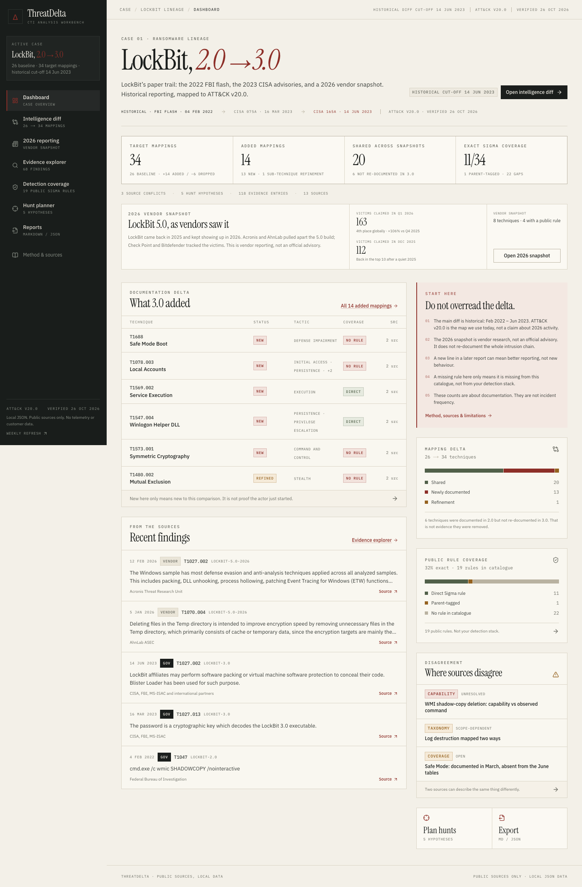
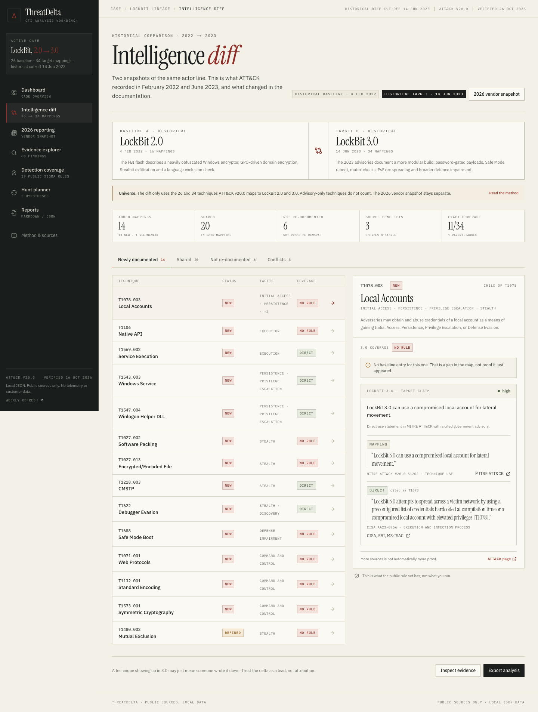
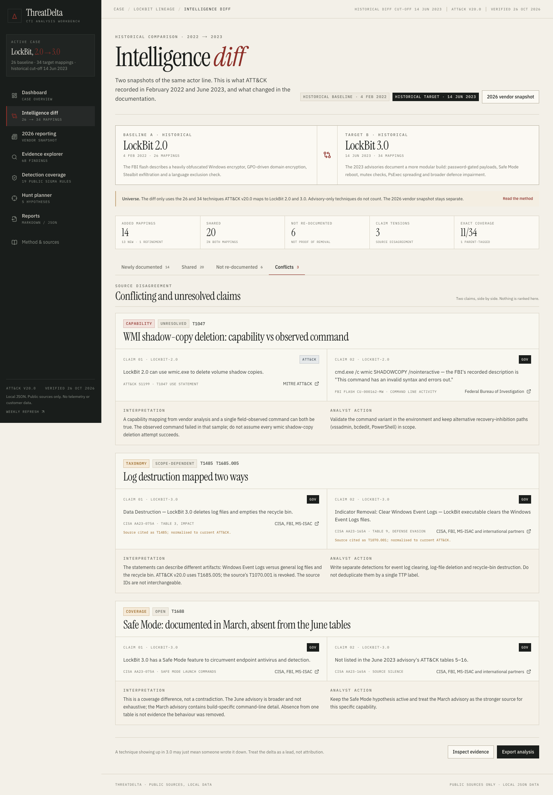
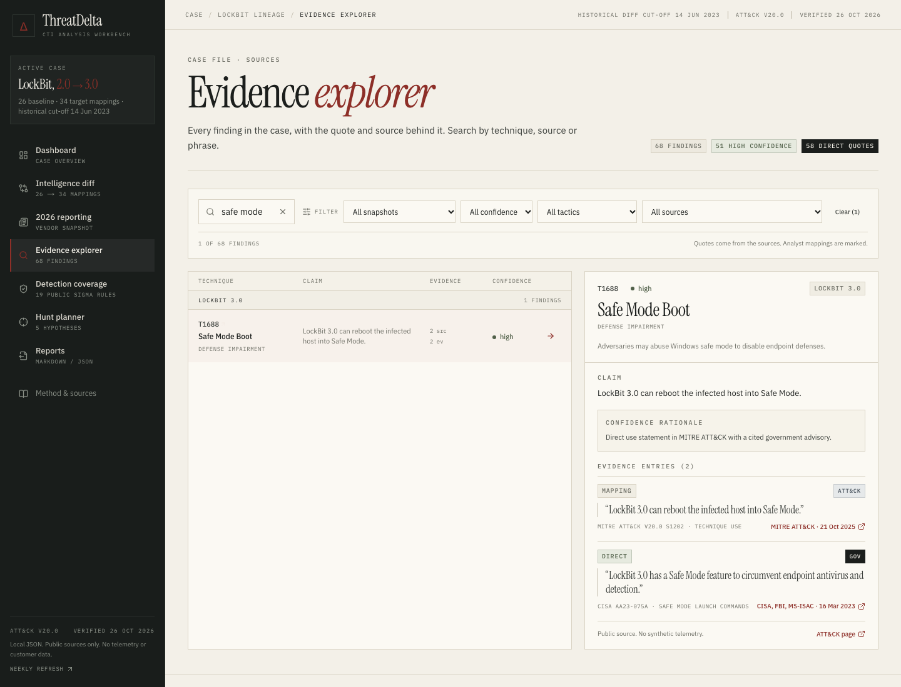
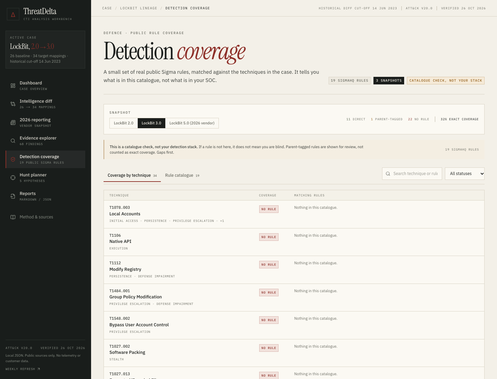
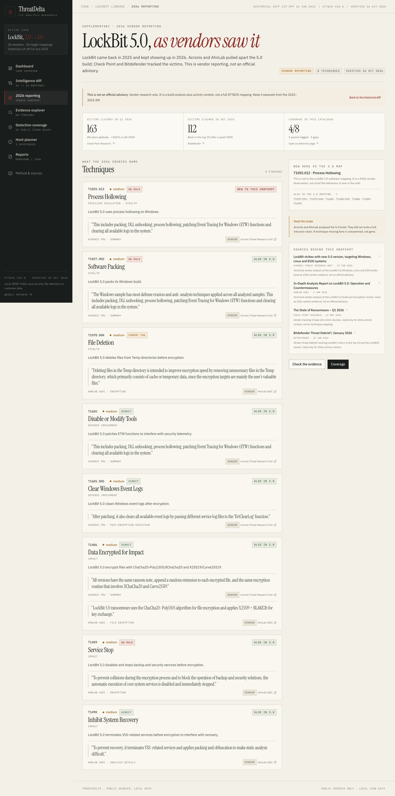
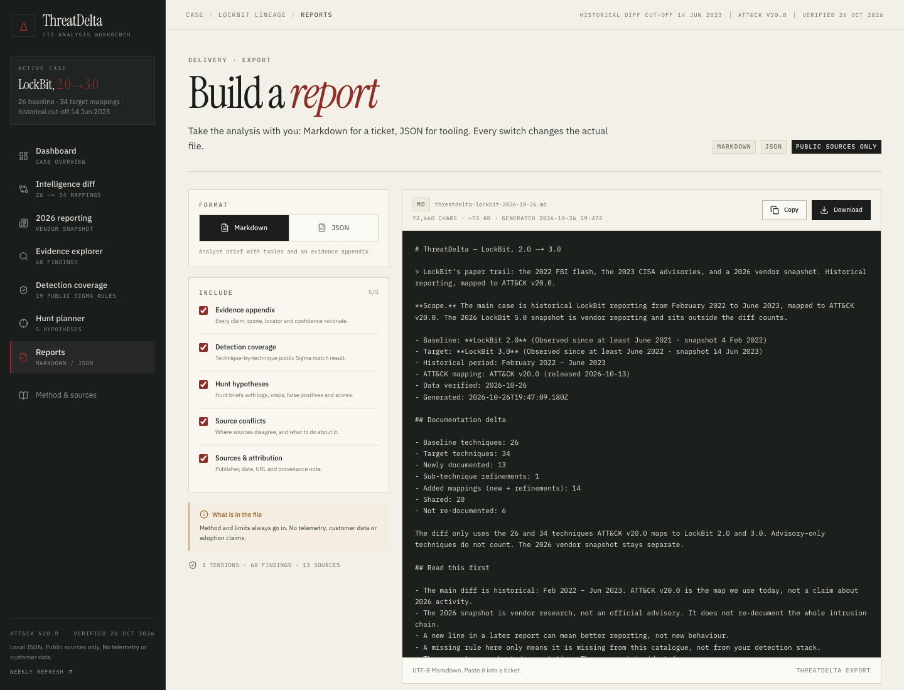

# ThreatDelta

A small CTI analyst workbench for comparing public cyber-threat reporting, inspecting the evidence behind ATT&CK mappings, reviewing public detection coverage, and turning documentation changes into testable hunt hypotheses.

Built with Next.js, TypeScript, Tailwind CSS and local JSON data. No backend, auth, paid APIs or required LLM calls.

**Live demo:** [threatdelta.vercel.app](https://threatdelta.vercel.app) · **Source:** private GitHub repository

## Data status

- **Historical case:** 4 February 2022 – 14 June 2023
- **Current ATT&CK mapping:** v20.0, released 13 October 2026
- **2026 vendor snapshot:** LockBit 5.0, 8 techniques from Acronis and AhnLab; activity context from Check Point and Bitdefender
- **Last verified:** 26 October 2026
- **SigmaHQ snapshot:** commit `05d1031` (21 October 2026), 19 rules pinned to that commit
- **Evidence footprint:** 68 findings, 118 evidence entries and 13 sources

The 2022–2023 dates are the historical case. The 2026 page is separate vendor reporting, not an official advisory and not part of the historical diff counts.

## Refresh pipeline

The repository has a real, review-gated refresh pipeline in `.github/workflows/refresh-intel.yml`:

- Runs every Monday at 06:00 UTC and on manual dispatch.
- Checks the official ATT&CK STIX index, the SigmaHQ `master` commit, and the CISA, FBI IC3, Unit 42 and SentinelOne Labs feeds.
- Machine-verifiable ATT&CK/Sigma changes update `data/` and open or update the `chore/intel-refresh` pull request.
- New advisory candidates and mapping changes that require judgement open or update a GitHub issue and are **not** converted into findings automatically.
- The workflow runs lint, typecheck, tests and a production build before opening the PR. It does not auto-merge.
- Workflow: https://github.com/YouFoundTheDev/threatdelta/actions/workflows/refresh-intel.yml

Run the same check locally with:

```bash
npm run refresh:intel
```

The check writes `refresh-summary.json`, `refresh-pr.md` and `refresh-issue.md` locally (ignored by Git). The in-app Method page links to the workflow and lists the monitored feeds.



## What it does

- **Dashboard** — case statistics and recent source findings derived from the actual dataset, with a documentation-delta view and explicit reading caveats.
- **Intelligence diff** — compares LockBit 2.0 and 3.0 ATT&CK mappings, separating new techniques, sub-technique refinements, shared techniques, techniques not re-documented, and source disagreements.
- **Evidence explorer** — searchable claims with source URLs, locators, direct quotes, ATT&CK IDs, confidence rationale, and the distinction between source evidence and derived mappings.
- **2026 reporting** — a separate LockBit 5.0 vendor snapshot with build-level findings, activity context, coverage and explicit scope limits.
- **Detection coverage** — matches documented techniques to 19 real public SigmaHQ rules and separates exact coverage, parent-tagged rules, and catalogue gaps.
- **Hunt planner** — five hypotheses with required logs, investigative steps, false positives, source references and a visible priority score.
- **Reports** — exports the selected analysis as Markdown or JSON, with evidence, coverage, hunts, conflicts and sources individually toggleable.
- **Method & sources** — the full confidence rubric, coverage semantics, priority formula, bibliography, dataset checks and limitations.

The full in-app methodology view is captured in [`screenshots/method.png`](screenshots/method.png).

## Case study

The case compares two public snapshots of the LockBit ransomware lineage:

| | Baseline | Target |
| --- | --- | --- |
| Snapshot | LockBit 2.0 | LockBit 3.0 (“LockBit Black”) |
| Public cut-off | 4 Feb 2022 | 14 Jun 2023 |
| Primary reporting | [FBI Flash CU-000162-MW](https://www.ic3.gov/CSA/2022/220204.pdf) | [CISA AA23-165A](https://www.cisa.gov/news-events/cybersecurity-advisories/aa23-165a) |
| Supporting report | — | [CISA AA23-075A](https://www.cisa.gov/news-events/cybersecurity-advisories/aa23-075a) |
| ATT&CK mapping | [S1199](https://attack.mitre.org/software/S1199/) | [S1202](https://attack.mitre.org/software/S1202/) |

The comparison universe is deliberately narrow: the **26** and **34** techniques mapped to the two ATT&CK software entries in ATT&CK v20.0. That produces:

- **13 newly documented techniques** and **1 sub-technique refinement** — 14 added mappings in total.
- **20 shared** techniques.
- **6 techniques** documented in 2.0 but not re-documented in 3.0.
- **3 conflicting / unresolved claims** where sources map the same space differently or a field observation contradicts a capability mapping.

The current catalogue covers **11 of 34** target techniques with an exact public Sigma rule, with **1** parent-tagged and **22** catalogue gaps. The UI says “newly documented”, never “newly adopted”. The diff is a lead for validation, not proof of behavioural change.

The historical reporting period is February 2022 – June 2023. ATT&CK v20.0 was released on 13 October 2026 and verified on 26 October 2026; it is the mapping layer, not a claim about the historical activity. The LockBit software objects themselves were last modified on 21 October 2025.

### 2026 vendor snapshot

The 2022–2023 diff is still the core case. Separately, the **2026 reporting** page covers the LockBit 5.0 build described by Acronis (12 Feb 2026) and AhnLab (5 Jan 2026), with activity context from Check Point Q1 2026 and Bitdefender January 2026.

- 8 techniques, 4 with exact Sigma coverage, 1 parent-tagged and 3 gaps.
- **Process hollowing (`T1055.012`)** is the only technique not already in the 3.0 mapping.
- 163 claimed victims in Q1 2026 (Check Point) and 112 in December 2025 (Bitdefender).
- This is vendor research, not an official advisory and not a complete intrusion chain. A technique missing there is unexamined, not gone.

## Screenshots

### Intelligence diff



### Conflicting claims



### Evidence explorer



### Detection coverage



Rule catalogue view: [`screenshots/detection-rules.png`](screenshots/detection-rules.png).

### 2026 reporting



### Hunt planner


### Reports



Mobile layouts are included in [`screenshots/mobile-dashboard.png`](screenshots/mobile-dashboard.png) and [`screenshots/mobile-menu.png`](screenshots/mobile-menu.png).

## Methodology

### 1. Snapshot construction

Each observed technique is one ATT&CK v20.0 software-mapping entry with a claim, confidence, source IDs and at least one evidence entry. Evidence is classified as:

- `direct` — an exact quote from a government, MITRE or vendor source, with a locator such as a table or section.
- `mapping` — the ATT&CK `uses` statement for the software entry.
- `analyst-note` — reserved for clearly labelled analyst synthesis; no synthetic evidence is currently used.

Direct quotes were checked against the fetched PDF/HTML source text. The dataset is locally stored in [`data/observations.json`](data/observations.json); source metadata is in [`data/sources.json`](data/sources.json).

### 2. Comparison rules

[`lib/diff.ts`](lib/diff.ts) compares exact ATT&CK IDs. A target ID absent from the baseline is:

- **new** if no baseline technique is one of its ancestors;
- **refined** if an ancestor exists in the baseline (for example `T1480.002` refining shared parent `T1480`);
- **not re-documented** in the reverse direction if a baseline technique is absent from the target mapping (not proof of removal).

The parent/child logic is in [`lib/attack.ts`](lib/attack.ts). Source disagreements are curated separately in [`data/conflicts.json`](data/conflicts.json), with claims shown side by side rather than ranked.

### 3. Confidence

- **High** — direct primary-source quote, or a MITRE use statement backed by a cited government advisory.
- **Medium** — MITRE mapping supported mainly by vendor reporting or a single source.
- **Low** — weak or inferred support; kept visible if used.

### 4. Detection coverage

[`lib/detection.ts`](lib/detection.ts) matches each documented technique against 19 real rules from the public [SigmaHQ repository](https://github.com/SigmaHQ/sigma), all pinned to the verified commit:

- **Direct** — the rule carries the exact technique ID. Counted as coverage.
- **Parent-tagged** — the rule carries an ancestor ID. Shown for review, but not counted as exact coverage.
- **Child-only** — a narrower rule; related, but it cannot cover the whole parent.
- **Gap** — no exact or parent-tagged rule in this catalogue.

The catalogue is a sample, not an organisational detection inventory. A missing public rule is never presented as a lack of detection.

### 5. Hunt priority

[`lib/hunt.ts`](lib/hunt.ts) uses an additive, visible rubric with a maximum of 11:

```text
documentation delta  (new 3, refinement 2, shared 1)
+ tactic exposure    (impact / initial access 3,
                      lateral movement / defence impairment 2,
                      other 1)
+ detection gap      (no rule 3, parent-tagged 1, direct 0)
+ evidence strength  (high 2, medium 1)
```

The UI shows every factor and its points. Priority is a planning heuristic, not a probability or a claim that a technique is active in any environment.

## Sources

- FBI, *Indicators of Compromise Associated with LockBit 2.0 Ransomware*, Flash CU-000162-MW, 4 Feb 2022 — https://www.ic3.gov/CSA/2022/220204.pdf
- CISA/FBI/MS-ISAC, *#StopRansomware: LockBit 3.0*, AA23-075A, 16 Mar 2023 — https://www.cisa.gov/news-events/cybersecurity-advisories/aa23-075a
- CISA/FBI/MS-ISAC and international partners, *Understanding Ransomware Threat Actors: LockBit*, AA23-165A, 14 Jun 2023 — https://www.cisa.gov/news-events/cybersecurity-advisories/aa23-165a
- MITRE ATT&CK, *ATT&CK v20.0 release* (13 Oct 2026) — https://github.com/mitre-attack/attack-stix-data/releases/tag/v20.0
- MITRE ATT&CK, *LockBit 2.0 (S1199)* — https://attack.mitre.org/software/S1199/
- MITRE ATT&CK, *LockBit 3.0 (S1202)* — https://attack.mitre.org/software/S1202/
- SentinelOne Labs, *LockBit 3.0 Update*, 21 Jul 2022 — https://www.sentinelone.com/labs/lockbit-3-0-update-unpicking-the-ransomwares-latest-anti-analysis-and-evasion-techniques/
- Palo Alto Networks Unit 42, *LockBit 2.0: How This RaaS Operates and How to Protect Against It*, 9 Jun 2022 — https://unit42.paloaltonetworks.com/lockbit-2-ransomware/
- Acronis Threat Research Unit, *LockBit strikes with new 5.0 version, targeting Windows, Linux and ESXI systems*, 12 Feb 2026 — https://www.acronis.com/en/tru/posts/lockbit-strikes-with-new-50-version-targeting-windows-linux-and-esxi-systems/
- AhnLab ASEC, *In-Depth Analysis Report on LockBit 5.0: Operation and Countermeasures*, 5 Jan 2026 — https://asec.ahnlab.com/en/91945/
- Check Point Research, *The State of Ransomware – Q1 2026*, 11 May 2026 — https://research.checkpoint.com/2026/the-state-of-ransomware-q1-2026/
- Bitdefender, *Bitdefender Threat Debrief | January 2026*, 13 Jan 2026 — https://www.bitdefender.com/en-us/blog/businessinsights/bitdefender-threat-debrief-january-2026
- SigmaHQ, public detection rules at commit `05d1031` (21 Oct 2026) — https://github.com/SigmaHQ/sigma/commit/05d1031f537e830b76da53bae2400c5814c89165

Unit 42 and SentinelOne are background for MITRE mappings cited in the dataset. The 2026 Acronis/AhnLab pieces drive the 2026 technique snapshot; Check Point and Bitdefender are activity context only.

## Run locally

Requires Node.js 24.x (see `.nvmrc`).

```bash
npm install
npm run dev
```

Open http://localhost:3000.

```bash
npm test             # 38 Vitest tests
npm run lint         # ESLint
npm run typecheck    # tsc --noEmit
npm run build        # production build
npm start            # serve the production build
npm run refresh:intel # check upstream ATT&CK, SigmaHQ and report feeds
```

No environment variables are required. The app is deployable to Vercel as-is; all routes except `/reports` are static, and `/reports` is request-time rendered to stamp the export.

## Verification

Last verified locally with Node 24 and Next.js 16.4.3:

- `npm run lint` — clean.
- `npm run typecheck` — clean.
- `npm test` — 38 passed across comparison, ATT&CK v20.0 provenance, Sigma matching, 2026 vendor data, refresh-pipeline fixtures, hunt prioritisation and report exports.
- `npm run build` — successful.

Tests include regression checks for the 26/34/20/14/6 historical counts, the `T1480.002` refinement rule, the 2026 8-technique snapshot, the v20.0 dataset manifest, parent-vs-exact Sigma matching, pinned SigmaHQ commit URLs, refresh-core mapping and feed parsing, broken source references, synthetic-label enforcement, report option toggles and JSON export shape.

Architecture notes for maintainers live in [`docs/ARCHITECTURE.md`](docs/ARCHITECTURE.md).

## Project structure

```text
app/            routes: dashboard, diff, evidence, detections, hunts, reports, method
components/     workbench UI, shared signals and primitives
lib/            comparison, ATT&CK matching, coverage, hunts, reports, provenance
data/           case, sources, techniques, observations, conflicts, rules, hunts, dataset manifest, monitoring
scripts/        refresh-core.mjs and refresh-intel.mjs
tests/          Vitest suites for logic, exports and refresh fixtures
screenshots/    desktop and mobile captures
.github/        CI and scheduled refresh workflows
```

Comparison and export logic is kept out of the UI components. The data files are plain JSON and can be replaced with another case without changing the core diff, coverage or scoring code.

## Limitations

- **Documentation is not adoption.** A later report can add a technique because reporting improved, a new source was cited, or a mapping changed. This workbench does not infer adversary behaviour change.
- **The universe is not exhaustive.** Advisory-only techniques (for example some exfiltration mappings) are outside the S1199/S1202 comparison counts. This is stated in the diff.
- **ATT&CK identifiers drift.** ATT&CK v20.0 uses `T1685.005` for Clear Windows Event Logs; `T1070.001` is revoked. `T1562.001` is also revoked in favor of `T1685`. The dataset uses current IDs while preserving source `citedAs` labels.
- **The 2026 snapshot is vendor reporting.** Acronis and AhnLab analysed the build; Check Point and Bitdefender tracked activity. It is not an official advisory, and it does not cover the full intrusion chain.
- **The Sigma catalogue is small.** It contains 19 real public rules, not an organisational detection inventory. Parent-tagged matches need validation.
- **No telemetry or IOCs.** The app deliberately avoids stale indicators and does not include victim, customer or incident data.
- **Hunt hypotheses need local validation.** Required logs and false positives are starting points; field availability and retention must be confirmed.
- **Three conflicts are curated examples, not exhaustive adjudication.** They are shown to demonstrate how to keep disagreement visible.

## Attribution

ATT&CK technique metadata is from the MITRE ATT&CK Enterprise dataset v20.0 (released 13 October 2026; verified 26 October 2026). Advisory quotes remain attributable to their publishers. SigmaHQ rule titles, IDs, tags and links are reproduced as metadata pinned to commit `05d1031`; rule text remains under the [SigmaHQ Detection Rule License 1.1](https://github.com/SigmaHQ/Detection-Rule-License).
